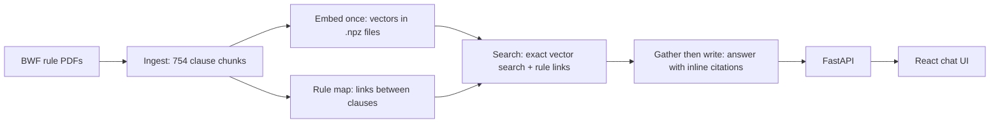

# Badminton Rules Bot

When a rule question comes up on court, the answer is somewhere in three BWF rule books, and nobody carries them in their bag. We wanted a chat app where you ask the question and get a clear answer, with the exact rule it comes from.

A good umpire knows which page to open, reads the rules that page points to, and says so when the book has no answer. That's the job we gave the bot.

It's also how we learn RAG, one lab at a time. We measured every choice before we kept it.

> **Status:** the bot answers end to end. We're building the web chat now (Lab 7).

**[Ask it a question](#ask-it-a-question)** · **[What we tested](#what-we-tested)** · **[How it works](#how-it-works)** · **[Setup](#setup)** · **[References](#references)**

---

## Ask it a question

> **Q:** We forgot to switch ends at 11 in the third game and only noticed at 14-12. What now?
>
> **A:** Change ends now, as soon as the mistake is discovered and when the shuttle is not in play [2]. The existing score of 14-12 shall stand [3]. In the third game, players must change ends when a side first scores 11 points, except in Handicap Matches [1].
>
> [1] Laws of Badminton 5.0 (2), Clause 8.1.3 · [2] Clause 8.2 · [3] Clause 8.2

> **Q:** what is mazimum player can have in each side
>
> **A:** A side can have a maximum of two players [1] [2]. A match is the basic contest in Badminton between opposing sides, each of one or two players [1]. Doubles is a match where there are two players on each of the opposing sides [2], while singles is a match where there is one player on each of the opposing sides [3].
>
> [1] Laws of Badminton 5.0 (2), Introduction (Match) · [2] Introduction (Doubles) · [3] Introduction (Singles)

The first answer came from our test run on 17 Nov. The second came from the chat app the same day, typo and all, in 47 s. Each number points to a sentence in the rule book, and code copies that sentence in word for word, so the model never retypes a quote. In the app, each number opens its quote and a link to the PDF page.

## Why it's hard

People don't ask in the rule book's words. "I play from a chair" is a Para Badminton question, and the word "para" never appears in it. "Can I serve higher in the new format?" is about the Alternative Laws, which only come into force in January 2027. Sometimes the books have no answer at all, and then the bot has to say so.

The bot reads three books: the Laws of Badminton, the Instructions to Technical Officials (ITTO) and the Alternative Laws. Together they hold 754 clauses.

Before we wrote any search code, we wrote 39 test questions and split them once, 27 to tune on and 12 locked away for the final score. Each run changed one thing, each result went into `evals/runs.jsonl`, and each decision got a short record in [`docs/decisions`](docs/decisions/README.md) with the options we turned down and why. There are 28 records so far.

---

## What we tested

These are the choices that shaped the bot. Every number comes from the record linked after it.

**How big is one chunk?** We tried three sizes: one clause, a window of about 300 words, and a whole section. At the same amount of text, single clauses scored as well or better every time, with recall of 0.924 against 0.882 for sections at about 400 words. A clause is also the thing an umpire points to, so it's easy to cite. ([0001](docs/decisions/0001-test-section-groups-as-a-third-chunking.md))

We also put a small header on each clause with the book, the heading and the clause number. It found about 2 more questions in every search type, with no model call. Vector recall went from 0.764 to 0.840. ([0003](docs/decisions/0003-add-a-context-header-to-every-chunk.md))

**Which search?** This one surprised us.

| Search on clauses (dev questions, top 5) | Recall |
| --- | --- |
| **Vector search** (Mistral Embed) | **0.840** |
| Hybrid search (keyword and vector) | 0.771 |
| Keyword search (BM25) | 0.576 |

Hybrid search is the usual recommendation, and on our clauses it never beat vector search. A clause is short, so a question in everyday words shares almost none of its words. On those questions keyword search scored 0.427 and vector search 0.823. ([0006](docs/decisions/0006-vector-search-on-clauses-goes-to-stage-2.md))

**More results, or the links between rules?**

| Sources the model reads (22 questions) | Passed | Cost per question |
| --- | --- | --- |
| Top 5 clauses | 14 | $0.010 |
| **Top 5 clauses and the rule map** | **16** | **$0.011** |
| Top 55 clauses and the rule map | 15 | $0.028 |

The rule map follows the links the books already write down, such as which Alternative Law replaces which Law, and which clause cites another. It works like an umpire who flips from one Law to the clause it points to. With the map, the top 5 passed 16 of 22 for about a cent a question. The top 55 passed 15 and cost more than twice as much. ([0009](docs/decisions/0009-top-5-plus-rule-links.md))

**Plain RAG, an agent, or both?** Before the run, we guessed that searching first and then giving the model tools would match the agent for less money. It passed more questions than the agent too.

| Setup (11 unseen questions, 3 runs, out of 30) | Passed | Cost per question |
| --- | --- | --- |
| A. Plain RAG (search once, then answer) | 17 | $0.030 |
| B. Agent (the model searches with tools) | 22 | $0.056 |
| **C. RAG first, then the tools** | **26** | **$0.037** |

([0021](docs/decisions/0021-setup-c-goes-to-phase-2.md))

**How do we know a win is real?** We ran the same flow twice and got 31 and 35 out of 41, with 10 questions changing their result. Since then, every flow runs 3 times, and we only call a win when the score ranges don't overlap. ([0026](docs/decisions/0026-call-a-win-with-3-runs-per-flow.md))

The first change to pass that test was one natural answer with inline citations, in place of one line per rule. It scored 89.8 to 92.1, against 82.0 to 84.6. ([0027](docs/decisions/0027-one-natural-answer-with-inline-citations.md))

### What still fails

We scored the 12 locked questions once, and 7 of 10 answers passed. Diagrams reach the bot only as their captions. Three questions fail in every flow, the black card question among them, because search never finds the clause that holds the missing fact.

Next is the web chat. If you try the bot and it gets a rule wrong, please send us the question.

---

## How it works



1. **Ingest** (`scripts/build_rule_chunks.py`): reads each PDF with PyMuPDF and cuts it into one chunk per clause.
2. **Rule map** (`scripts/build_rule_links.py`): writes the 232 links between clauses that search can't see, to `data/rule_links.json`.
3. **Embed** (`scripts/build_embeddings.py`): embeds every clause and question once, and saves the vectors as `.npz` files, so eval runs call no embedding API.
4. **Search** (`retrieval/`): an exact vector search with NumPy, then the clauses the rule map links to the top 5.
5. **Answer** (`answer_flows/`): a tool loop gathers the sentences that answer each part. Code refuses when none do. Then a write call writes one answer with `[n]` citations. The app calls it through `load_rules_bot()` in `answer_flows/rules_bot.py`.
6. **Serve and chat:** FastAPI in `app/` has `/health` and `POST /chat`, which streams the answer as server-sent events. Until slice 4 of [the spec](docs/specs/ask-a-rules-question.md), `/chat` answers from a stub bot, so it costs nothing to call. The React chat page lives in `frontend/` (Vite, React and TypeScript).

<details>
<summary><b>Traps in the rule books, and how we fixed them</b></summary>

- **Hidden clause numbers:** the Laws PDF draws numbers such as 1.4 as tiny pictures, so text extraction drops them. A picture at the left margin now starts the next clause.
- **Para Badminton clauses:** these are printed in italics. Ingest reads the font and flags 22 clauses, so they stay out of answers about regular play.
- **Repeated clause numbers:** the Alternative Laws repeat the same numbers for each scoring format, so each chunk id carries its format.
- **Overrides and cross-references:** the rule map links each alternative to the Law it replaces, and each clause to the clauses it cites.
- **Versions:** every clause carries its version and in-force date, and alternatives arrive labelled "not in force until 2027-01-04".

</details>

**The labs.** 0 Setup ✅ · 1 Search types ✅ · 2 Break and fix 🔜 · 3 Agents ✅ · 4 Context enrichment ✅ · 5 Pick the approach ✅ · 6 Evals and citations ✅ · 7 React chat 🔄. Raw notes are in [`workshop/notes.md`](workshop/notes.md).

---

## Setup

Needs [uv](https://docs.astral.sh/uv/). It installs Python 3.12 and the packages.

```bash
cp .env.example .env    # then paste MISTRAL_API_KEY and ANTHROPIC_API_KEY into .env
uv sync                 # install packages
uv run pytest           # tests, no API calls, no network
```

**Get the corpus.** The rule-book PDFs are never committed. Download the three files from the [references](#references) and save them in `data/bwf/` with these names:

```
bwf-laws-of-badminton-2025-v5.0.pdf
bwf-itto-2025-v7.0.pdf
bwf-alternative-laws-2027-v2.0.pdf
```

**Build and check the chunks.**

`DATABASE_URL` can stay empty: no code reads it yet.

```bash
uv run python -m scripts.build_rule_chunks       # writes data/rule_chunks.json
uv run python -m scripts.build_rule_links        # writes data/rule_links.json
uv run python -m scripts.build_embeddings        # writes data/embeddings/*.npz (calls Mistral)
uv run python -m scripts.check_golden_questions  # every answer location found?
```

When it works, the check prints `golden questions: 39 | duplicate ids: 0` and `phase2 questions: 41 | duplicate ids: 0`, each followed by `missing locations: none`, and ends with `in both sets: none`.

**Check the rule map and the other question sets.** None of these calls an API; the last two read the saved vectors.

```bash
uv run python -m scripts.check_rule_links        # which multi-clause questions one hit plus the map solves
uv run python -m scripts.check_unseen_questions  # each unseen question's tag against vector search
uv run python -m scripts.check_refusal_probes    # no clause answers a refusal probe
```

**Start the server and the chat page.**

```bash
uv run uvicorn app.main:app --reload   # FastAPI on http://127.0.0.1:8000 (try /health)
cd frontend && npm install && npm run dev   # the chat page on http://localhost:5173
```

The page talks only to Vite on port 5173, and Vite passes `/chat` on to FastAPI on port 8000.

---

## Stack

| Part | Tool |
| --- | --- |
| API | FastAPI, Uvicorn |
| PDF reading | PyMuPDF |
| Keyword search | BM25 (`rank-bm25`), kept for the comparisons |
| Vector search | Mistral Embed, vectors saved as `.npz` files, exact search with NumPy |
| Rule map | `data/rule_links.json`, built from the rule books |
| Answer models | Mistral (answers), Claude (the judge and the comparison) |
| Chat UI | React, TypeScript and Vite *(in progress)* |

---

## References

**Corpus: BWF Statutes** ([statutes page](https://corporate.bwfbadminton.com/statutes/))
- [Section 4.1 · Laws of Badminton, V5.0, in force 26 April 2025](https://extranet.bwf.sport/docs/document-system/81/1466/1470/Section%204.1%20-%20Laws%20of%20Badminton%20-%2026%20April%202025%20V5.0%20(2)%20.pdf)
- [Section 4.1.1 · Instructions to Technical Officials (ITTO), V7.0, in force 26 April 2025](https://extranet.bwf.sport/docs/document-system/81/1466/1470/Section%204.1.1%20-%20Instructions%20to%20Technical%20Officials%20(ITTO)%20-%2026%20April%202025%20V7.0%20(5).pdf)
- [Section 4.1.4 · Alternative Laws of Badminton, V2.0, in force 4 January 2027](https://extranet.bwf.sport/docs/document-system/81/1466/1470/Section%204.1.4%20-%20Alternative%20Laws%20of%20Badminton%20-%2004%20January%202027%20(V2.0).pdf)
- *Kept for later, and not in the bot yet:* [Section 4.1.1.1 · Instructions to Para Badminton Technical Officials, V5.0](https://extranet.bwf.sport/docs/document-system/81/1466/1470/Section%204.1.1.1%20-%20Instruction%20to%20Para%20Badminton%20Technical%20Officials%20(PBITTO)%20-%2026%20April%202025%20V5.0%20(2.1).pdf)
- [BWF news: updates to the Laws (May 2025)](https://corporate.bwfbadminton.com/news-single/2025/05/02/updates-to-bwf-laws-and-regulations-2): why V5.0 matters (the spin-serve ban, Law 9.1.5).

> The rule books belong to BWF. This repo does not copy them. You download them yourself.

**Tools**
- [FastAPI](https://fastapi.tiangolo.com/) · [uv](https://docs.astral.sh/uv/) · [PyMuPDF](https://pymupdf.readthedocs.io/)
- [rank-bm25](https://github.com/dorianbrown/rank_bm25) · [NumPy](https://numpy.org/)
- [Mistral docs](https://docs.mistral.ai/) · [Claude docs](https://docs.claude.com/)

---

## Learn this way

Want to learn a topic the way this repo was learned? Try **building-interactive-lessons**, my open-source skill. It turns any topic, or your own code, into an interactive lesson with AI as your tutor:
- Ask the tutor when a step is unclear.
- Practise on parts of real code, with a hint and a solution for each exercise.
- Get your answers checked by AI.

👉 `<interactive-lessons-repo-url>`

---

## License

`<license>`. The BWF rule books are not covered by this licence.
