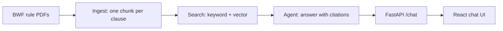

# Badminton Rules Bot · a RAG learning track

A web chat bot that answers badminton rule questions from the official BWF rule books, and cites the exact clause.

Built one lab at a time, to learn how an agent app with RAG really works: FastAPI on the back end, React on the front end.

**[Lab map](#lab-map)** · **[RAG challenges](#rag-challenges-and-how-we-handle-them)** · **[Setup](#setup)** · **[References](#references)** · **[Learn this way](#learn-this-way)**

> **Status:** learning in progress. Lab 0 is done. Lab 1 is running. Labs 2–7 are an outline, written up as each lab is done.

---

## What a rule looks like to the bot

The bot never searches whole PDFs. It searches **one clause at a time**. This is a real record from `data/rule_chunks.json`:

```json
{
  "id": "laws-9.1.6",
  "document_title": "Laws of Badminton",
  "version": "5.0 (2)",
  "in_force": "2025-04-26",
  "clause": "9.1.6",
  "heading": "9. SERVICE",
  "para_only": false,
  "page": 6,
  "text": "the whole shuttle shall be below 1.15 metres from the surface of the court at the instant of being hit by the server’s racket;",
  "search_text": "Laws of Badminton · 9. SERVICE · Clause 9.1.6\nthe whole shuttle shall be below 1.15 metres …"
}
```

Search reads `search_text`: a short header with the document, the format, the para flag and the heading, then the clause. A clause alone often lacks that context. Clause 16.2.1 sets the interval at 8 points in the best-of-3 format and 6 in the best-of-5 one, and neither text names its format. The header follows Anthropic's [Contextual Retrieval](https://www.anthropic.com/news/contextual-retrieval), built from the tags instead of by a model.

Because every chunk is one clause, every answer can cite it: *"Law 9.1.6, Laws of Badminton V5.0"*.

**Result:** no demo yet. A live link and a real chat screenshot go here after Lab 7.

---

## How it works



1. **Ingest** (`scripts/build_rule_chunks.py`): reads each PDF line by line with PyMuPDF, then cuts it into clauses. Runs once.
2. **Search** (`retrieval/`): finds the clauses that match a question, by words (BM25) and by meaning (vectors in pgvector).
3. **Answer** (`answer_flows/`): one folder per way of answering, with `shared/` for what they all use: `single_call/` (one call, no tools), `one_call_with_tools/` (a tool loop, then the answer) and `gather_then_write/` (a tool loop picks the sentences, code decides a refusal, a write call answers). `experiments/run_answer_experiment.py` runs any setup with any flow it allows.
4. **Serve** (`app/`): FastAPI. Today it has only `/health`. `/chat` comes later.
5. **Chat UI** *(planned)*: a React web chat.

---

## Lab map

Each lab teaches one technique on the same corpus.

| Lab | What it teaches · status |
| --- | --- |
| **0 · Setup** | Project skeleton, settings, corpus, golden questions · ✅ done |
| **1 · Search types** | Keyword (BM25) vs vector search, tokenizers · 🔄 running |
| **2 · Break and fix** | Find where retrieval fails, then fix it · 🔜 planned |
| **3 · How agents perform** | Agent loop, tool calls, when to search again · 🔜 planned |
| **4 · Context enrichment** | Add headings, links and versions to each chunk · 🔜 planned |
| **5 · Pick the approach** | Compare the options on the golden set · 🔜 planned |
| **6 · Evals and citations** | Score answers, check citations, detect "no answer" · 🔜 planned |
| **7 · React chat UI** | Web chat on top of the FastAPI service · 🔜 planned |

Raw notes from each lab live in [`workshop/notes.md`](workshop/notes.md).

---

## RAG challenges and how we handle them

### Done

**Hidden clause numbers**
- **Problem:** the Laws PDF draws two-level numbers (1.4., 7.5.) as tiny pictures. Text extraction drops them, so Law 1.4 (post height) loses its number.
- **Fix:** a small picture at the left margin starts the next clause, counted in order under its Law heading. A test checks that 1.4 maps to the 1.55 m posts line.

**Para badminton clauses**
- **Problem:** some clauses apply only to para badminton. They must not leak into answers for regular play.
- **Fix:** the Laws print them in italics, so ingest reads the font and sets `para_only: true` (22 chunks). Headings and diagram titles have no font, so they never count as para.

**Repeated clause numbers**
- **Problem:** the Alternative Laws repeat the same clause numbers for each scoring option.
- **Fix:** the chunk id carries the option, such as `alt-best-of-5-games-11:8.1.5`.

**Clause numbers that share a line**
- **Problem:** in the ITTO, a clause number and its text sometimes sit in one piece of PDF text ("5.2.2.     Get into the Umpire's chair"). 18 clauses hid inside the clause before them, including the warm-up rule.
- **Fix:** in the ITTO, a clause starts at a number with a final dot, or a number followed by two or more spaces. A cross-reference that wraps onto a new line ("16.7 applied") has neither.
- `tests/test_rule_chunks.py` (37 tests) checks every chunk's shape, counts, clause numbers and tags, and that no clause number is left inside another chunk.

**A golden set before any search**
- 39 questions in 9 categories, written before any retrieval code. 13 use the rule book's own words, 26 are paraphrased. Each is tagged dev (27) or held-out (12), once.
- `scripts/check_golden_questions.py` checks that every answer location still exists in the chunks.

### Open · outline, written up when we do it

**Overrides** *(Lab 1–4)*
- **Problem:** the Alternative Laws replace some standard Laws (for example 9.1.6, the service height). No chunk says "9.1.6 has an alternative".
- **Plan:** to be written.

**Cross-references** *(Lab 2–4)*
- **Problem:** the ITTO cites the Laws about 55 times ("see Law 9.1"). One answer can need two documents.
- **Plan:** to be written.

**Image references** *(Lab 4–7)*
- **Problem:** court diagrams and the umpire hand signals exist only as images. 4 golden questions need an image in the answer.
- **Plan:** to be written.

**Versions and in-force dates** *(Lab 6)*
- **Problem:** the Alternative Laws V2.0 come into force on 4 January 2027. Answers about them change meaning on that date.
- **Plan:** to be written.

**"No answer" and attacks** *(Lab 6)*
- **Problem:** 3 golden questions have no answer in the rule books, and 2 try to make the bot break its rules.
- **Plan:** to be written.

---

## Setup

Needs [uv](https://docs.astral.sh/uv/). It installs Python 3.12 and the packages.

```bash
cp .env.example .env    # then paste your keys and DATABASE_URL into .env
uv sync                 # install packages
uv run pytest           # tests, no API calls, no network
```

**Get the corpus.** The rule-book PDFs are never committed. Download the three files from the [references](#references) and save them in `data/bwf/` with these names:

```
bwf-laws-of-badminton-2025-v5.0.pdf
bwf-itto-2025-v7.0.pdf
bwf-alternative-laws-2027-v2.0.pdf
```

**Build and check the chunks.**

```bash
uv run python -m scripts.build_rule_chunks            # writes data/rule_chunks.json
uv run python -m scripts.check_golden_questions  # every answer location found?
```

When it works, the check prints `questions: 35 | duplicate ids: 0` and `missing locations: none`.

**Start the server.**

```bash
uv run uvicorn app.main:app --reload   # then open http://127.0.0.1:8000/health
```

---

## Stack

| Part | Tool |
| --- | --- |
| API | FastAPI, Uvicorn |
| PDF reading | PyMuPDF |
| Keyword search | BM25 (`rank-bm25`, `bm25s`, PyStemmer) |
| Vector search | Mistral Embed + pgvector on Supabase Postgres |
| Answer models | Mistral (main), Claude (comparison) |
| Chat UI | React *(planned)* |

---

## References

**Corpus: BWF Statutes** ([statutes page](https://corporate.bwfbadminton.com/statutes/))
- [Section 4.1 · Laws of Badminton, V5.0, in force 26 April 2025](https://extranet.bwf.sport/docs/document-system/81/1466/1470/Section%204.1%20-%20Laws%20of%20Badminton%20-%2026%20April%202025%20V5.0%20(2)%20.pdf)
- [Section 4.1.1 · Instructions to Technical Officials (ITTO), V7.0, in force 26 April 2025](https://extranet.bwf.sport/docs/document-system/81/1466/1470/Section%204.1.1%20-%20Instructions%20to%20Technical%20Officials%20(ITTO)%20-%2026%20April%202025%20V7.0%20(5).pdf)
- [Section 4.1.4 · Alternative Laws of Badminton, V2.0, in force 4 January 2027](https://extranet.bwf.sport/docs/document-system/81/1466/1470/Section%204.1.4%20-%20Alternative%20Laws%20of%20Badminton%20-%2004%20January%202027%20(V2.0).pdf)
- *Kept for later, not ingested:* [Section 4.1.1.1 · Instructions to Para Badminton Technical Officials, V5.0](https://extranet.bwf.sport/docs/document-system/81/1466/1470/Section%204.1.1.1%20-%20Instruction%20to%20Para%20Badminton%20Technical%20Officials%20(PBITTO)%20-%2026%20April%202025%20V5.0%20(2.1).pdf)
- [BWF news: updates to the Laws (May 2025)](https://corporate.bwfbadminton.com/news-single/2025/05/02/updates-to-bwf-laws-and-regulations-2): why V5.0 matters (the spin-serve ban, Law 9.1.5).

> The rule books belong to BWF. This repo does not copy them. You download them yourself.

**Tools**
- [FastAPI](https://fastapi.tiangolo.com/) · [uv](https://docs.astral.sh/uv/) · [PyMuPDF](https://pymupdf.readthedocs.io/)
- [pgvector](https://github.com/pgvector/pgvector) · [bm25s](https://github.com/xhluca/bm25s) · [rank-bm25](https://github.com/dorianbrown/rank_bm25)
- [Mistral docs](https://docs.mistral.ai/) · [Claude docs](https://docs.claude.com/)

---

## Learn this way

Want to learn a topic the way this repo was learned? Try **building-interactive-lessons**, my open-source skill. It turns any topic, or your own code, into an interactive lesson with AI as your tutor:
- Ask the tutor when a step is unclear.
- Practise on parts of real code, with a hint and a solution for each exercise.
- Get your answers checked by AI.

👉 `<interactive-lessons-repo-url>`

---

## License

`<license>`. The BWF rule books are not covered by this licence.
