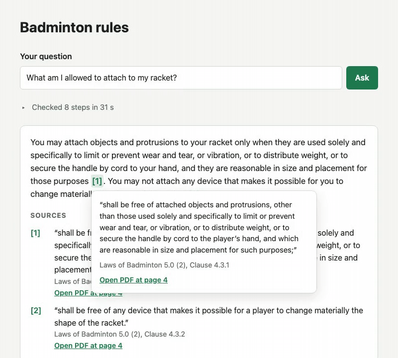
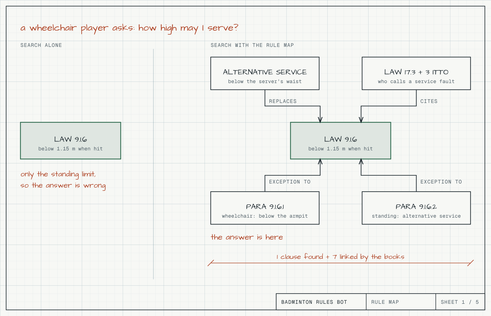
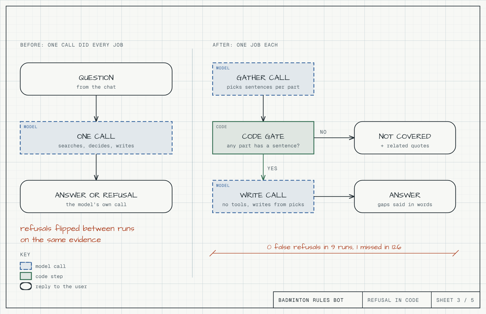
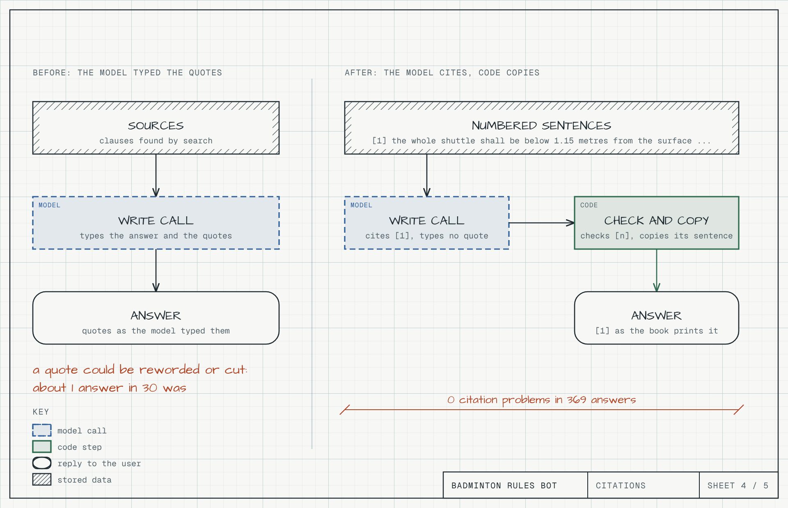
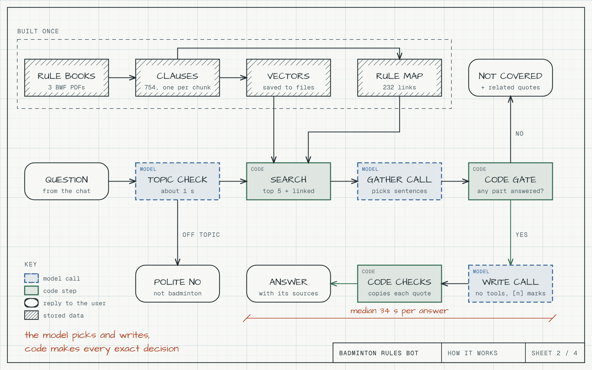

# Badminton Rules Bot

**Ask a badminton rule question. Get a short answer that quotes the exact clause from the official BWF rule books, or a clear answer that the rules don't cover it.**

<p align="center">
  
</p>

**[What it does](#what-it-does)** · **[Three hard parts](#three-hard-parts)** · **[What I measured](#what-i-measured)** · **[What still fails](#what-still-fails)** · **[How it works](#how-it-works)** · **[Try it](#try-it)**

> **Status:** the chat works end to end on my machine, with the real bot on Mistral models. It isn't hosted. You can run it locally with no API cost, using the stub bot ([Try it](#try-it)).

---

## What it does

When a rule question comes up on court, the answer is somewhere in three BWF rule books, and nobody carries them in their bag. The bot reads all three (754 clauses) and behaves like a good umpire: it opens the right page, follows the clauses that page points to, and says so when the books have no answer.

| The rules don't cover it | Not about badminton |
| --- | --- |
|  |  |
| Searches, finds no rule, says so, and quotes the nearest rules. 22 s in this clip. | A small model screens the question first, so the bot says no in under a second. |

Every number in an answer opens its quote and a link to the PDF page. Code copies each quote from the rule book word for word, so the model never retypes one. The clips are real runs. Long waits are sped up, and the label says by how much.


I built it end to end, as practice for shipping RAG products, and measured every choice before I kept it. Each decision has a short record in [`docs/decisions`](docs/decisions/README.md) (36 so far), with the options I turned down and the runs behind it. I wrote most of the code with AI coding tools, under my review.

---

## Three hard parts

**1. One clause carries too little context.**
A clause's exception often sits in another book: the Alternative Laws replace some Laws, and Para Badminton clauses sit beside the regular ones. The Laws PDF even draws clause numbers as tiny pictures, so text extraction drops them.
**Fix:** one chunk per clause, rebuilt from the page layout, plus a *rule map* of the 232 links the books write down (which Alternative Law replaces which Law, which clause cites another). Search finds a clause, and the map brings along its linked clauses. Result: 16 of 22 questions passed with the map, and 14 without it ([0009](docs/decisions/0009-top-5-plus-rule-links.md)). On 40 new questions locked before any run, the map also cut the tool rounds on linked-rule questions from 0.45–0.65 to 0.15 per question ([final test](#final-test--40-new-questions-locked-before-any-run)).

For example, a wheelchair player asks how high they may serve. Search finds the serve-height Law, but on its own that clause gives the standing player's limit. The rule map brings along the clauses the books link to it, and one of them holds the answer:

<picture>
  <source media="(prefers-color-scheme: dark)" srcset="docs/images/rule-map-dark.png">
  
</picture>

**2. The model judged its own evidence.**
At first, one model call did three jobs: it searched, decided whether to refuse, and wrote the answer. It made refusal errors, and the errors flipped between runs on the same evidence.
**Fix:** split the job. A *gather call* only picks the sentences that answer each part of the question. **Code** then refuses when no part has a sentence. A *write call* with no tools writes the answer from the picked sentences. Result: across the Phase 2 runs of this flow on 14–17 Nov, 0 of 210 should-refuse answers were missed and 0 of 405 answerable ones were refused. The one-call flow it replaced, which already refused in code from its picked sentences, missed 1 of 42 on 14 Nov, and 3 of 42 on 20 Nov (the same question every time), on the same 41 questions. Fewer false refusals is not a gain I can claim: in the final test below, a plain tool-calling agent made 0 false refusals and this design made 1. ([0023](docs/decisions/0023-move-exact-work-from-prompt-rules-to-code.md))

<picture>
  <source media="(prefers-color-scheme: dark)" srcset="docs/images/refusal-in-code-dark.png">
  
</picture>

**3. Citations drifted from the rule text.**
When the model typed its own quotes, it paraphrased them or dropped parts: 44 of 1,245 saved answers from Stages 2 and 3 quote words that aren't in the clause they cite (about 1 in 28).
**Fix:** the model cites a sentence by its number, and **code** copies the sentence in, checks every `[n]` marker, and checks that every answer sentence carries one. Result: 0 such quotes in the 820 answers of the Phase 2 runs of 14–17 Nov (one answer had a broken `[n]` marker, which the check caught). This is exact by construction: it says every quote matches the rule book, not that every claim matches its quote, which the judge checks separately. ([0023](docs/decisions/0023-move-exact-work-from-prompt-rules-to-code.md), [0027](docs/decisions/0027-one-natural-answer-with-inline-citations.md))

<picture>
  <source media="(prefers-color-scheme: dark)" srcset="docs/images/citations-by-number-dark.png">
  
</picture>

The pattern behind all three: **the model makes one judgement at a time, and code does everything that has an exact answer.**

---

## What I measured

Before writing any search code, I wrote 39 test questions and split them once: 27 to tune on, 12 locked away for one final score. Each run changed one thing, and each result went into `evals/runs.jsonl`. Numbers from different stages are never compared with each other.

### Stages 1 to 3 · Building the pipeline

**Stage 1 · Which search?** (24 answerable dev questions, top 5 results)

| Search on clauses | Recall@5 | Hit@5 |
| --- | --- | --- |
| **Vector search** (Mistral Embed) | **0.840** | **0.958** |
| Hybrid search (keyword and vector) | 0.771 | 0.958 |
| Keyword search (BM25) | 0.576 | 0.708 |

Recall@5 is the share of each question's answer clauses found in the top 5. Hit@5 is the share of questions with at least one answer clause in the top 5.

Hybrid search is the usual advice. On these clauses it tied vector search on hit@5 and never beat it on recall. A clause is short, so a question in everyday words shares almost none of its words. ([0006](docs/decisions/0006-vector-search-on-clauses-goes-to-stage-2.md))

**Stage 2 · More results, or the links between rules?** (22 questions)

| Sources the model reads | Passed · cost per question |
| --- | --- |
| Top 5 clauses | 14 · $0.010 |
| **Top 5 clauses and the rule map** | **16 · $0.011** |
| Top 55 clauses and the rule map | 15 · $0.028 |

([0009](docs/decisions/0009-top-5-plus-rule-links.md))

**Stage 3 · Plain RAG, an agent, or both?** (11 unseen questions, 3 runs, out of 30)

| Setup | Passed · cost per question |
| --- | --- |
| A. Plain RAG (search once, then answer) | 17 · $0.030 |
| B. Agent (the model searches with tools) | 22 · $0.056 |
| **C. RAG first, then the tools** | **26 · $0.037** |

I predicted C would match B for less money. It also passed more questions. ([0021](docs/decisions/0021-setup-c-goes-to-phase-2.md))

### Phase 2 · A better way to score answers

41 questions. Measurement restarted here, so these numbers are compared only with each other.

**The problem with pass or fail**

- An answer passed only when every check passed, so the pass count didn't show which check failed.
- It was noisy. Run twice with nothing changed, the same flow passed 31 and then 35 of 41 questions, and 10 questions flipped between pass and fail.
- That swing of 4 questions is bigger than the gain from a real design change: splitting the gather call from the write call moved the pass count by 1 ([0023](docs/decisions/0023-move-exact-work-from-prompt-rules-to-code.md)). With one run per flow, luck could pass for a win.

**The new design** ([0026](docs/decisions/0026-call-a-win-with-3-runs-per-flow.md), [0027](docs/decisions/0027-one-natural-answer-with-inline-citations.md))

1. **A scorecard for every answer.** Each check is logged as pass or fail on its own, so a run shows where answers fail, not only how many.
2. **One combined score out of 100**, weighted by how much each check matters:
    - the facts are correct: 30
    - every claim is backed by its quoted rule: 35
    - the answer does what the question's test expects: 10
    - it refuses only when it should: 10
    - it reads well: 15
    - valid citations and the right clause stay as pass-or-fail gates, with no weight
3. **3 runs per flow.** I call a win only when the two flows' score ranges don't overlap. When they do overlap, the flow with steadier runs is preferred.

**The split on its own did not win.** One call against the gather and write calls, 3 runs each, graded by the same judge as the answer-style test below: 82.8 to 87.0 against 82.4 to 84.6 (the third split run was lost). The split made every answer grounded (1.0 against 0.85–0.90), but its answers read worse. The two flows also write from different prompts, so that readability drop likely comes from the prompt, not the split (not yet tested), and this test isn't clean. The split cost 28% more per answer ($0.0119 against $0.0093).

**The first win: the answer style.** Take "We forgot to switch ends at 11 and noticed at 14-12. What now?" The old style gave Law 8.2(1) and Law 8.2(2) as two separate lines, each starting with its rule book name. The new style gives one connected reply, "switch now and keep 14-12", with the citations inline.

| Answer style | Combined score, 3 runs |
| --- | --- |
| One line per part of the question | 82.0 to 84.6 |
| **One connected answer, inline citations** | **89.8 to 92.1** |

Most of the gain came from readability. The facts scored about the same, and the scorecard is what showed it.

### Final test · 40 new questions, locked before any run

The 12 locked golden questions were scored once, on the Stage 2 setup. To test the final design, I wrote 40 new questions and locked them before any run: 10 not about badminton, 10 about badminton that no rule answers, and 20 that need a linked rule (Alternative Laws, Para Badminton, cross-cited clauses). Every run records the file's hash. It is one test: the three flows ran on the same 40 questions, 3 times each, taking turns, on 21 Nov. A tool round is one turn in which the model calls the search or read tools. Code scored every answer. The judge's lines (correct, grounded) wait for a re-grade, so they aren't here.

| Range over 3 runs | Plain agent | Final design | Final design, no rule map |
| --- | --- | --- | --- |
| Tool rounds, linked-rule questions | 1.8–2.1 | **0.15** | 0.45–0.65 |
| Tool rounds, all questions | 2.53–2.80 | **0.80–0.93** | 1.05–1.28 |
| Cost per question | $0.017–0.022 | **$0.011–0.012** | $0.011–0.013 |
| Missed refusals, of 20 | 1–2 | 0–1 | 1 |

- **Against a plain tool-calling agent,** the final design took 67% fewer tool rounds and cost 41% less per question. The ranges don't overlap. The cost saving comes from this mix, where half the questions should be refused: on the 20 linked-rule questions alone, the cost was about the same ($0.0106–0.0109 against $0.0097–0.0115), and the design was a little slower (median 15–19 s against 13–17 s). The design's first search runs before the model and isn't a tool round. Note: the plain agent has the rule map too. Its search tool returns each hit with the clauses the map links to. So this comparison measures the whole design (search before the tools, the topic screen, the gather and write calls), not the map. The map's own effect is the design against the design without the map.
- **The rule map alone** cut tool rounds on linked-rule questions by 74%.
- **Refusals didn't separate the flows.** Most misses are one question I labelled "not covered" that is answerable: the officials' instructions do cover phones and other devices on court (ITTO 5.15.1). Read that way, the design's one refusal of it (run 1) was a false refusal too. The design's one false refusal (the plain agent made none) is real: the topic screen turned away a wheelchair question in every run.

([`experiments/run_final_experiment.py`](experiments/run_final_experiment.py), questions in [`evals/final_experiment_questions.json`](evals/final_experiment_questions.json))

**The topic screen.** A small model checks each question before any search. An off-topic question now gets its reply in about 0.6 s, for $0.00004 (measured over 3 check runs of 112 questions). Before the screen, such a question went through the full search: a live "test" took 15 s and 77 s. Its cost was never logged, so I don't claim a saving in percent. The screen adds the same 0.6 s and $0.00004 to every badminton question, and it can be wrong (see [What still fails](#what-still-fails)).

Not every idea won. Records [0011](docs/decisions/0011-complete-answers-rule-not-adopted.md) and [0001](docs/decisions/0001-test-section-groups-as-a-third-chunking.md) are ideas I tested and dropped.

---

## What still fails

- **The locked questions:** scored once at Stage 2. 7 of the 10 that need an answer passed, and both questions that need a refusal were refused.
- **Three questions fail in every flow** (the black card among them): search never finds the clause that holds the missing fact.
- **Diagrams** reach the bot only as their captions.
- **The topic screen can turn away a real rules question.** In the final test it called "Can a wheelchair have extra support wheels, …?" off topic in every run.
- **"Not covered" answers read like a log** ("The sources do not say…", then raw related quotes), and can quote a loosely related rule, as in the racket-weight clip.
- **Answers are slow:** a median of 34 s, from 9 to 104 s (122 answers, 17 Nov). The page shows each step while it waits.

If the bot gets a rule wrong, please [open an issue](https://github.com/chayapol-p/badminton-rules-bot/issues) with the question.

---

## How it works

<picture>
  <source media="(prefers-color-scheme: dark)" srcset="docs/images/how-it-works-dark.png">
  
</picture>

Blue dashed boxes are model calls and green boxes are code. The model makes one judgement at a time, and code makes every exact decision.

- **Ingest** (`scripts/`): reads each PDF with PyMuPDF, one chunk per clause. It flags Para Badminton clauses by their italic font and names each Alternative Laws clause by its scoring format.
- **Answer flow** (`answer_flows/`): the app calls it through one entry point, `load_rules_bot()` in `answer_flows/rules_bot.py`. Older flows stay runnable in `experiments/retired_flows/`, so every logged result can be reproduced.
- **Evals** (`evals/`): code checks first (citations, numbers, refusals), then a judge from another model family (Claude) for the rest, by majority of 3.
- **App:** FastAPI in `app/` streams progress and the answer as server-sent events. The chat page in `frontend/` is Vite, React and TypeScript.
- **Tests:** 389 Python tests, 31 page tests and 7 browser tests. None calls a paid API.

---

## Try it

Needs [uv](https://docs.astral.sh/uv/) and Node.js. The stub bot answers every question with one saved answer and refuses one set question, so you can click through the whole page at no cost. None of these steps needs a real API key, but the app won't start with the Mistral key left empty.

```bash
git clone https://github.com/chayapol-p/badminton-rules-bot && cd badminton-rules-bot
cp .env.example .env     # then type any placeholder after MISTRAL_API_KEY=
uv sync
uv run python -m scripts.download_rule_books   # the 3 BWF rule books, checked against their frozen hashes
uv run python -m scripts.build_rule_chunks     # 754 clauses, so each citation links to its PDF page
uv run uvicorn app.main:app              # the API on http://127.0.0.1:8000
cd frontend && npm install && npm run dev   # in a second terminal: the chat on http://localhost:5173
```

For real answers you need a Mistral key and two more build steps (the rule map and the vectors). See [docs/setup.md](docs/setup.md).

---

## References

**Corpus: BWF Statutes** ([statutes page](https://corporate.bwfbadminton.com/statutes/))
- [Laws of Badminton, V5.0, in force 26 April 2025](https://extranet.bwf.sport/docs/document-system/81/1466/1470/Section%204.1%20-%20Laws%20of%20Badminton%20-%2026%20April%202025%20V5.0%20(2)%20.pdf)
- [Instructions to Technical Officials (ITTO), V7.0, in force 26 April 2025](https://extranet.bwf.sport/docs/document-system/81/1466/1470/Section%204.1.1%20-%20Instructions%20to%20Technical%20Officials%20(ITTO)%20-%2026%20April%202025%20V7.0%20(5).pdf)
- [Alternative Laws of Badminton, V2.0, in force 4 January 2027](https://extranet.bwf.sport/docs/document-system/81/1466/1470/Section%204.1.4%20-%20Alternative%20Laws%20of%20Badminton%20-%2004%20January%202027%20(V2.0).pdf)

> The rule books belong to BWF. This repo does not copy them. You download them yourself.

**Learn this way.** I built the labs of this repo as interactive lessons with [building-interactive-lessons](https://github.com/chayapol-p/interactive-lessons), my open-source skill that turns any topic or code repo into a lesson with an AI tutor.

## License

[MIT](LICENSE). The BWF rule books are not covered by this licence.
